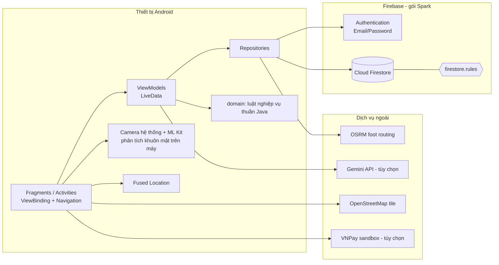

# Kiến trúc hệ thống và công nghệ

## 0. Công nghệ và lý do lựa chọn

| Thành phần | Lựa chọn | Lý do |
|---|---|---|
| Nền tảng | Android native, **Java 17** | Đề yêu cầu ứng dụng Android; Java là ngôn ngữ của môn học, tương thích đầy đủ với AndroidX/Firebase |
| SDK | `minSdk 26` (Android 8.0) · `compile/targetSdk 36` | minSdk 26 phủ phần lớn thiết bị đang dùng và có `java.time`; target 36 theo yêu cầu Google Play cho app mới |
| Kiến trúc | **MVVM** (Android Architecture Components) | Tách UI khỏi logic, ViewModel sống qua xoay màn hình, LiveData tự hủy theo vòng đời → ít rò rỉ, dễ test |
| UI | Material 3 · ViewBinding · Navigation Component | Giao diện thống nhất, binding an toàn kiểu (không `findViewById`), điều hướng khai báo bằng graph cho 2 vai trò |
| Xác thực | **Firebase Authentication** (Email/Password) | Quản lý mật khẩu an toàn, không tự lưu mật khẩu |
| CSDL | **Cloud Firestore** + Security Rules | Đề khuyến nghị CSDL trên cloud (Firebase); đồng bộ thời gian thực; Rules thực thi phân quyền khi không có server riêng |
| eKYC | Camera hệ thống + **ML Kit Face Detection** | Phát hiện khuôn mặt + nụ cười chạy trên máy, miễn phí, không gửi ảnh ra dịch vụ thứ ba |
| Bản đồ | **osmdroid** (OpenStreetMap) + **OSRM** (profile đi bộ) | Không cần API key/billing như Google Maps; OSRM trả đường đi bộ ngắn nhất |
| Thanh toán | **VNPay sandbox** (HMAC-SHA512) + cổng SANDBOX mô phỏng | Đề cho phép VNPay *hoặc* Stripe; VNPay phổ biến ở Việt Nam |
| Chatbot | Bộ luật ý định tiếng Việt + **Gemini** (tùy chọn) | Trả lời tức thời, có liên kết sang chức năng, không phụ thuộc mạng; Gemini cho câu hỏi tự do |
| Build / môi trường | Gradle (Kotlin DSL, version catalog) · Docker · GitHub Actions | Phiên bản thư viện tập trung ở `gradle/libs.versions.toml`; build/test tái lập được, không phụ thuộc máy cá nhân |

## 1. Nguyên lý và mẫu thiết kế áp dụng

| Nguyên lý / mẫu | Áp dụng cụ thể |
|---|---|
| **MVVM** | `Fragment/Activity` chỉ hiển thị và bắt sự kiện; `ViewModel` giữ trạng thái (`LiveData<Resource<T>>`); `Repository` truy cập dữ liệu |
| **Repository** | `AuthRepository`, `UserRepository`, `AccountRepository`, `TransactionRepository`, `KycRepository`, `RateRepository`, `BranchRepository` che giấu Firebase |
| **Observer** | `QueryLiveData`/`DocumentLiveData` bọc `addSnapshotListener`, tự đăng ký/hủy theo vòng đời → UI cập nhật thời gian thực, không rò listener |
| **Single Responsibility** | Luật nghiệp vụ thuần Java trong `domain/` (không import Android/Firebase) → kiểm thử bằng JUnit trên JVM |
| **Strategy-lite** | `TxType` quyết định cách `TransactionRepository.commit` ghi bản ghi và cập nhật số dư |
| **Template Method** | `BaseShellActivity` dựng khung (toolbar, NavHost, bottom nav, chặn sai vai trò); hai lớp con chỉ khai báo graph/menu/vai trò |
| **Facade** | `TransactionFlow` gom chuỗi: kiểm tra → xác minh mặt → OTP → ghi, dùng chung cho mọi chức năng tiền |
| **Event (single-live-event)** | `Event<T>` + `BaseViewModel.operation()` để thông báo thành công/lỗi đúng một lần |
| **Defense in depth** | Kiểm tra ở UI → `domain/TransactionRules` → `firestore.rules` |
| **Immutability** | `transactions` chỉ tạo, không sửa/xóa; `txId` sinh sẵn nên thử lại không trừ tiền hai lần |

## 2. Sơ đồ giải pháp (solution / infrastructure)

## 3. Phân lớp

1. **ui/** – hiển thị, validate đầu vào nhanh, điều hướng.
2. **viewmodel/** – điều phối, không giữ tham chiếu View.
3. **domain/** – quy tắc: giới hạn tiền, phí, hạn mức ngày, ngưỡng giá trị cao, OTP, lãi, lịch vay, khoảng cách, nhận diện ý định chatbot, ký URL VNPay.
4. **data/** – truy cập Firestore/Auth/HTTP; `WriteBatch` cho tính nguyên tử.
5. **firestore.rules** – thực thi quyền, đúng số dư, bất biến giao dịch.

## 4. Quyết định thiết kế quan trọng và lý do

| Quyết định | Lý do | Đánh đổi |
|---|---|---|
| Gói **Spark**, không Cloud Functions | Nhóm chưa có Firebase project/thẻ thanh toán | OTP, xác nhận cổng thanh toán, hạn mức ngày **không thể thực thi phía server** ([limitations.md](limitations.md)) |
| Đăng nhập bằng *username → email bí danh* `@tdtbank.app` | Firebase Email/Password cần email; khách hàng do nhân viên cấp | Email bí danh không nhận được thư |
| Nhân viên tạo Auth user bằng **FirebaseApp phụ** | Không làm đăng xuất nhân viên | Nếu ghi Firestore lỗi sau khi tạo Auth, còn một Auth user mồ côi |
| Số dư đổi bằng `FieldValue.increment` + `lastTxId` | Không cần đọc số dư người nhận (không có quyền đọc); rules so khớp `getAfter` | Mỗi giao dịch chạm tối đa 2 tài khoản |
| Ảnh KYC nén JPEG Base64 trong Firestore | Storage cần gói Blaze | Giới hạn ~300 KB/ảnh, tốn băng thông |
| osmdroid + OSRM thay Google Maps | Không cần API key/billing | Máy chủ OSRM công cộng có giới hạn dùng; ảnh bản đồ phụ thuộc OSM |
| Target API 36 | Google Play yêu cầu từ 31/08/2026 cho app mới | Bắt buộc edge-to-edge (xử lý bằng `fitsSystemWindows`) |
