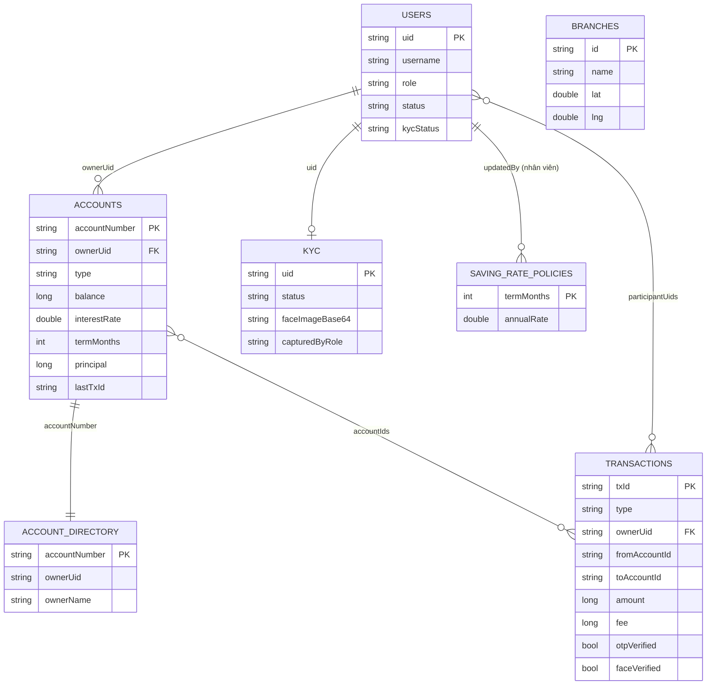

# Thiết kế cơ sở dữ liệu (Cloud Firestore)

Cloud Firestore là CSDL NoSQL dạng document: mỗi *collection* tương ứng một "bảng", mỗi *document* là một "dòng".
Không có khóa ngoại thật; quan hệ được giữ bằng trường tham chiếu (`ownerUid`, `accountIds`…) và được `firestore.rules` kiểm tra khi ghi.

## Sơ đồ ER

## Quan hệ

| Quan hệ | Bản số | Trường liên kết | Ghi chú |
|---|---|---|---|
| `users` → `accounts` | 1 – n | `accounts.ownerUid = users.uid` | Một khách hàng có nhiều tài khoản (checking/saving/mortgage) |
| `users` → `kyc` | 1 – 0..1 | `kyc/{uid}` cùng id với `users/{uid}` | Hồ sơ eKYC của khách hàng |
| `accounts` → `accountDirectory` | 1 – 1 | cùng id = số tài khoản | Bản công khai tối thiểu để tra tên người nhận |
| `accounts` ↔ `transactions` | n – n | `transactions.accountIds[]`, `fromAccountId`, `toAccountId` | Một giao dịch chạm tối đa 2 tài khoản |
| `users` ↔ `transactions` | n – n | `transactions.participantUids[]`, `ownerUid` | Người gửi và người nhận đều thấy giao dịch |
| `users` (nhân viên) → `savingRatePolicies` | 1 – n | `updatedBy` | Nhân viên chỉnh lãi suất theo kỳ hạn |

## Các collection

Tất cả số tiền là **số nguyên VND** (kiểu `long` trong Java ↔ `int` trong Rules). Enum lưu dạng chuỗi.

### users/{uid}
`uid, username, role(CUSTOMER|OFFICER), fullName, phone, contactEmail, nationalId, address, dateOfBirth(yyyy-MM-dd), status(ACTIVE|LOCKED), kycStatus(NONE|PENDING|VERIFIED|REJECTED), createdAt, createdBy`

### kyc/{uid}
`uid, fullName, faceImageBase64, status(PENDING|VERIFIED|REJECTED), capturedBy, capturedByRole, faceDetected, livenessPassed, reviewedBy, note, updatedAt`

### accounts/{accountNumber}  (10 chữ số, id = số tài khoản)
`accountNumber, ownerUid, ownerName, type(CHECKING|SAVING|MORTGAGE), status, balance, interestRate(%/năm), termMonths, principal, paymentFrequency(MONTHLY|BIWEEKLY), startDate, lastTxId, createdAt`
- CHECKING/SAVING: `balance` = số dư. SAVING dùng `interestRate`, `termMonths`.
- MORTGAGE: `balance` = **dư nợ gốc còn lại**, `principal` = số vay ban đầu.

### accountDirectory/{accountNumber}
`accountNumber, ownerUid, ownerName, type` — cho phép tra tên người nhận khi chuyển nội bộ mà không mở quyền đọc tài khoản.

### transactions/{txId}  (bất biến)
`type, ownerUid, fromAccountId, toAccountId, participantUids[], accountIds[], amount, fee, principalPortion, description, category, reference, counterpartyBank, counterpartyName, gateway, status, otpVerified, faceVerified, createdAt`

| type | fromAccountId | toAccountId | Tác động số dư |
|---|---|---|---|
| DEPOSIT | `EXTERNAL` | tài khoản của mình | đích +amount |
| WITHDRAW | tài khoản của mình | `CASH` | nguồn −amount |
| TRANSFER_INTERNAL | tài khoản của mình | tài khoản bất kỳ trong TDT Bank | nguồn −amount, đích +amount |
| TRANSFER_INTERBANK | tài khoản của mình | `INTERBANK` | nguồn −(amount+7.700) |
| UTILITY_PAYMENT | tài khoản của mình | `UTILITY` | nguồn −amount |
| MORTGAGE_PAYMENT | tài khoản thanh toán | tài khoản vay | nguồn −amount, dư nợ −principalPortion |

### savingRatePolicies/{termMonths}
`termMonths, annualRate, updatedBy, updatedAt`

### branches/{id}
`name, address, phone, lat, lng`

## Truy vấn dùng trong ứng dụng (không cần composite index)
`accounts where ownerUid==`, `accounts where type==SAVING and termMonths==`, `transactions where participantUids array-contains`,
`transactions where accountIds array-contains`, `users where role==CUSTOMER`, `users where username==`, `kyc where status==PENDING`.
Sắp xếp được thực hiện phía client nên `firestore.indexes.json` để trống.

Quyền đọc/ghi từng collection: [security.md](security.md).
