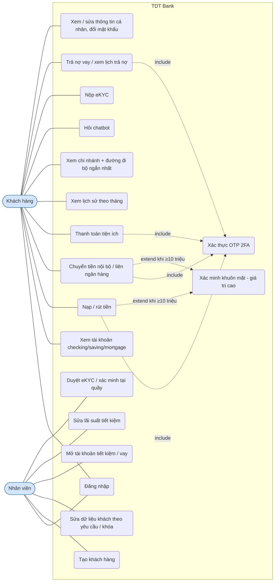
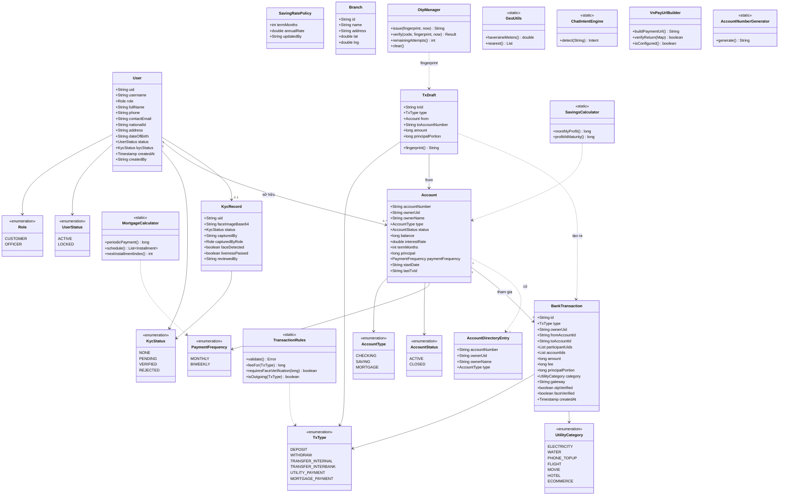
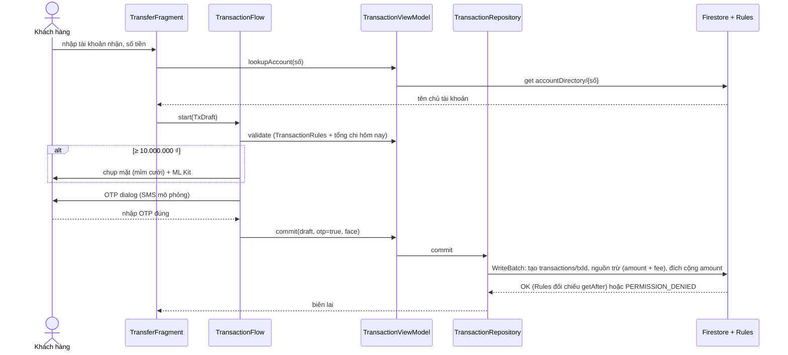
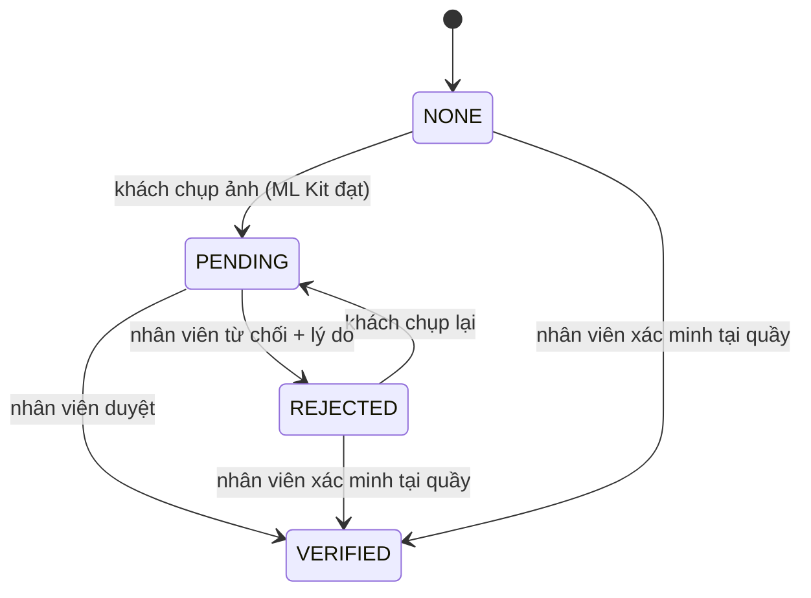
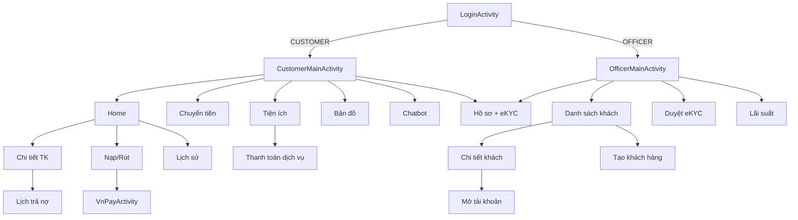

# Sơ đồ UML

Các sơ đồ dùng Mermaid (GitHub hiển thị trực tiếp; xuất ảnh cho báo cáo qua https://mermaid.live). Tên lớp, trường và quan hệ được viết theo mã nguồn hiện có.
Sơ đồ ER nằm ở [database.md](database.md).

## 1. Use case

## 2. Class diagram – model và domain

## 3. Class diagram – tầng dữ liệu và ViewModel

Ký hiệu: `<|--` kế thừa, `-->` phụ thuộc/sử dụng, `..>` gọi hàm tĩnh hoặc tạo đối tượng.

```mermaid
classDiagram
  class LiveData~T~ {
    <<AndroidX>>
  }
  class ViewModel {
    <<AndroidX>>
  }
  class QueryLiveData~T~ {
    snapshotListener theo vòng đời
  }
  class DocumentLiveData~T~ {
    snapshotListener theo vòng đời
  }
  class Resource~T~ {
    +Status status
    +T data
    +String message
  }
  class Event~T~ {
    +consume() T
  }
  class Callback~T~ {
    <<interface>>
    +onSuccess(T)
    +onError(String)
  }
  class FirebaseClient {
    <<static>>
    +auth()
    +db()
    +secondaryAuth()
    +isConfigured()
  }

  class AuthRepository {
    +login()
    +restoreSession()
    +logout()
    +changePassword()
    +createLoginAccount()
  }
  class UserRepository {
    +observeCustomers()
    +createCustomer()
    +officerUpdateCustomer()
    +setStatus()
    +updateOwnContact()
  }
  class AccountRepository {
    +observeAccounts()
    +observeAccount()
    +lookupDirectory()
    +openAccount()
    +generateUniqueNumber()
  }
  class TransactionRepository {
    +commit(TxDraft)
    +observeByUser()
    +observeByAccount()
    +getTodayOutgoing()
  }
  class KycRepository {
    +submit()
    +review()
    +observePending()
  }
  class RateRepository {
    +observePolicies()
    +updateRate()
    +createSamplePolicies()
  }
  class BranchRepository {
    +observeBranches()
  }
  class RoutingClient {
    +fetchWalkingRoute() Route
    +parse(json)$
  }
  class GeminiClient {
    +ask(String) String
    +isConfigured()$
  }
  class UtilityCatalog {
    +load(Context)$
    +providers()
    +items()
    +topupAmounts()
  }

  class BaseViewModel {
    <<abstract>>
    +operation() LiveData~Event~
  }
  class AuthViewModel
  class SessionViewModel
  class AccountViewModel
  class TransactionViewModel {
    +validate()
    +commit()
    +lookupAccount()
  }
  class OfficerViewModel
  class ProfileViewModel
  class ChatViewModel {
    +send(String)
  }
  class MapViewModel {
    +findNearest()
  }

  LiveData <|-- QueryLiveData
  LiveData <|-- DocumentLiveData
  ViewModel <|-- BaseViewModel
  ViewModel <|-- AuthViewModel
  ViewModel <|-- SessionViewModel
  ViewModel <|-- AccountViewModel
  ViewModel <|-- TransactionViewModel
  ViewModel <|-- ChatViewModel
  ViewModel <|-- MapViewModel
  BaseViewModel <|-- OfficerViewModel
  BaseViewModel <|-- ProfileViewModel
  QueryLiveData ..> Resource
  DocumentLiveData ..> Resource
  BaseViewModel ..> Event

  AuthRepository ..> FirebaseClient
  UserRepository ..> FirebaseClient
  AccountRepository ..> FirebaseClient
  TransactionRepository ..> FirebaseClient
  KycRepository ..> FirebaseClient
  RateRepository ..> FirebaseClient
  BranchRepository ..> FirebaseClient
  AccountRepository ..> QueryLiveData
  AccountRepository ..> DocumentLiveData
  AccountRepository ..> AccountNumberGenerator
  TransactionRepository ..> Callback

  AuthViewModel --> AuthRepository
  SessionViewModel --> AuthRepository
  SessionViewModel --> UserRepository
  AccountViewModel --> AccountRepository
  AccountViewModel --> TransactionRepository
  AccountViewModel --> RateRepository
  AccountViewModel --> AuthRepository
  TransactionViewModel --> TransactionRepository
  TransactionViewModel --> AccountRepository
  TransactionViewModel --> AuthRepository
  TransactionViewModel ..> TransactionRules
  OfficerViewModel --> UserRepository
  OfficerViewModel --> AccountRepository
  OfficerViewModel --> KycRepository
  OfficerViewModel --> RateRepository
  OfficerViewModel --> AuthRepository
  ProfileViewModel --> KycRepository
  ProfileViewModel --> UserRepository
  ProfileViewModel --> AuthRepository
  ChatViewModel --> AccountRepository
  ChatViewModel --> TransactionRepository
  ChatViewModel --> AuthRepository
  ChatViewModel --> GeminiClient
  ChatViewModel ..> ChatIntentEngine
  MapViewModel --> BranchRepository
  MapViewModel --> RoutingClient
  MapViewModel ..> GeoUtils
```

## 4. Class diagram – tầng giao diện (UI)

```mermaid
classDiagram
  class AppCompatActivity {
    <<AndroidX>>
  }
  class Fragment {
    <<AndroidX>>
  }
  class DialogFragment {
    <<AndroidX>>
  }
  class TdtBankApp {
    Application
  }
  class LoginActivity
  class BaseShellActivity {
    <<abstract>>
    toolbar + NavHost + bottom nav + chặn sai vai trò
  }
  class CustomerMainActivity
  class OfficerMainActivity
  class VnPayActivity {
    WebView sandbox
  }

  class HomeFragment
  class AccountDetailFragment
  class MortgageScheduleFragment
  class CashFragment
  class TransferFragment
  class HistoryFragment
  class UtilitiesFragment
  class UtilityPayFragment
  class BranchMapFragment
  class ChatFragment
  class ProfileFragment
  class CustomerListFragment
  class CustomerCreateFragment
  class CustomerDetailFragment
  class OpenAccountFragment
  class KycQueueFragment
  class RatesFragment

  class TransactionFlow {
    +start(TxDraft, Listener)
    +showReceipt()$
  }
  class OtpDialogFragment
  class FaceCaptureDialogFragment
  class OtpSession {
    <<static>>
    +issue()
    +manager() OtpManager
  }

  AppCompatActivity <|-- LoginActivity
  AppCompatActivity <|-- BaseShellActivity
  AppCompatActivity <|-- VnPayActivity
  BaseShellActivity <|-- CustomerMainActivity
  BaseShellActivity <|-- OfficerMainActivity
  DialogFragment <|-- OtpDialogFragment
  DialogFragment <|-- FaceCaptureDialogFragment
  Fragment <|-- HomeFragment
  Fragment <|-- TransferFragment
  Fragment <|-- CustomerListFragment

  LoginActivity --> AuthViewModel
  BaseShellActivity --> SessionViewModel
  HomeFragment --> AccountViewModel
  HomeFragment --> SessionViewModel
  AccountDetailFragment --> AccountViewModel
  MortgageScheduleFragment --> AccountViewModel
  CashFragment --> AccountViewModel
  HistoryFragment --> AccountViewModel
  UtilityPayFragment --> AccountViewModel
  TransferFragment --> AccountViewModel
  TransferFragment --> TransactionViewModel
  BranchMapFragment --> MapViewModel
  ChatFragment --> ChatViewModel
  ProfileFragment --> ProfileViewModel
  ProfileFragment --> SessionViewModel
  CustomerListFragment --> OfficerViewModel
  CustomerCreateFragment --> OfficerViewModel
  CustomerDetailFragment --> OfficerViewModel
  OpenAccountFragment --> OfficerViewModel
  KycQueueFragment --> OfficerViewModel
  RatesFragment --> OfficerViewModel

  TransferFragment --> TransactionFlow
  CashFragment --> TransactionFlow
  UtilityPayFragment --> TransactionFlow
  AccountDetailFragment --> TransactionFlow
  TransactionFlow --> TransactionViewModel
  TransactionFlow ..> FaceCaptureDialogFragment : giao dịch ≥ 10 triệu
  TransactionFlow ..> OtpDialogFragment
  OtpDialogFragment --> OtpSession
  OtpSession --> OtpManager
  CashFragment ..> VnPayActivity
  VnPayActivity ..> VnPayUrlBuilder
```

Tất cả Fragment trong sơ đồ đều kế thừa `Fragment` (chỉ vẽ 3 mũi tên kế thừa đại diện cho gọn). Adapter RecyclerView
(`AccountAdapter`, `TransactionAdapter`, `InstallmentAdapter`, `UtilityAdapter`, `ChatAdapter`, `CustomerAdapter`, `KycAdapter`, `RateAdapter`)
kế thừa `RecyclerView.Adapter` và được Fragment tương ứng tạo ra.

## 5. Sequence – chuyển tiền nội bộ có OTP (và khuôn mặt khi ≥ 10 triệu)

## 6. State – eKYC

## 7. Điều hướng

