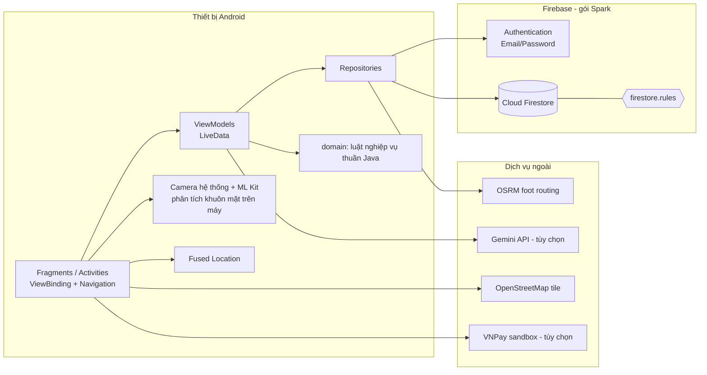

# Phân tích & Thiết kế kiến trúc

## 1. Nguyên lý và mẫu thiết kế áp dụng

| Nguyên lý / mẫu | Áp dụng cụ thể |
|---|---|
| **MVVM** | `Fragment/Activity` chỉ hiển thị và bắt sự kiện; `ViewModel` giữ trạng thái (`LiveData<Resource<T>>`); `Repository` truy cập dữ liệu |
| **Repository** | `AuthRepository`, `UserRepository`, `AccountRepository`, `TransactionRepository`, `KycRepository`, `RateRepository`, `BranchRepository` che giấu Firebase |
| **Observer** | `QueryLiveData`/`DocumentLiveData` bọc `addSnapshotListener`, tự đăng ký/hủy theo vòng đời → UI cập nhật thời gian thực, không rò listener |
| **Single Responsibility** | Luật nghiệp vụ thuần Java trong `domain/` (không import Android/Firebase) → kiểm thử bằng JUnit trên JVM |
| **Strategy-lite** | `TxType` quyết định cách `TransactionRepository.commit` ghi bản ghi và cập nhật số dư |
| **Template Method** | `BaseShellActivity` dựng khung (toolbar, NavHost, bottom nav, chặn sai vai trò); hai lớp con chỉ khai báo graph/menu/vai trò |
| **Facade** | `TransactionFlow` gom chuỗi: kiểm tra → xác minh mặt → OTP → ghi, dùng chung cho mọi chức năng tiền |
| **Event (single-live-event)** | `Event<T>` + `BaseViewModel.operation()` để thông báo thành công/lỗi đúng một lần |
| **Defense in depth** | Kiểm tra ở UI → `domain/TransactionRules` → `firestore.rules` |
| **Immutability** | `transactions` chỉ tạo, không sửa/xóa; `txId` sinh sẵn nên thử lại không trừ tiền hai lần |

## 2. Sơ đồ giải pháp (solution / infrastructure)

## 3. Phân lớp

1. **ui/** – hiển thị, validate đầu vào nhanh, điều hướng.
2. **viewmodel/** – điều phối, không giữ tham chiếu View.
3. **domain/** – quy tắc: giới hạn tiền, phí, hạn mức ngày, ngưỡng giá trị cao, OTP, lãi, lịch vay, khoảng cách, nhận diện ý định chatbot, ký URL VNPay.
4. **data/** – truy cập Firestore/Auth/HTTP; `WriteBatch` cho tính nguyên tử.
5. **firestore.rules** – thực thi quyền, đúng số dư, bất biến giao dịch.

## 4. Quyết định thiết kế quan trọng và lý do

| Quyết định | Lý do | Đánh đổi |
|---|---|---|
| Gói **Spark**, không Cloud Functions | Nhóm chưa có Firebase project/thẻ thanh toán | OTP, xác nhận cổng thanh toán, hạn mức ngày **không thể thực thi phía server** (docs/limitations.md) |
| Đăng nhập bằng *username → email bí danh* `@tdtbank.app` | Firebase Email/Password cần email; khách hàng do nhân viên cấp | Email bí danh không nhận được thư |
| Nhân viên tạo Auth user bằng **FirebaseApp phụ** | Không làm đăng xuất nhân viên | Nếu ghi Firestore lỗi sau khi tạo Auth, còn một Auth user mồ côi |
| Số dư đổi bằng `FieldValue.increment` + `lastTxId` | Không cần đọc số dư người nhận (không có quyền đọc); rules so khớp `getAfter` | Mỗi giao dịch chạm tối đa 2 tài khoản |
| Ảnh KYC nén JPEG Base64 trong Firestore | Storage cần gói Blaze | Giới hạn ~300 KB/ảnh, tốn băng thông |
| osmdroid + OSRM thay Google Maps | Không cần API key/billing | Máy chủ OSRM công cộng có giới hạn dùng; ảnh bản đồ phụ thuộc OSM |
| Target API 36 | Google Play yêu cầu từ 31/08/2026 cho app mới | Bắt buộc edge-to-edge (xử lý bằng `fitsSystemWindows`) |

## 5. Bảo mật (tóm tắt)

- Mật khẩu chỉ do Firebase Auth quản lý; không lưu ở Firestore hay log.
- OTP chỉ tồn tại trong RAM, lưu **băm SHA-256 có muối** gắn với txId+số tiền+đích, 2 phút, tối đa 3 lần, dùng một lần.
- Giao dịch ≥ 10.000.000 ₫ cần: eKYC `VERIFIED` (do nhân viên duyệt) + thử thách khuôn mặt (mỉm cười) + OTP.
- `allowBackup=false`, `usesCleartextTraffic` mặc định false (target ≥ 28).
- `firestore.rules`: mặc định từ chối; chi tiết ở file và docs/rbac-matrix.md.
