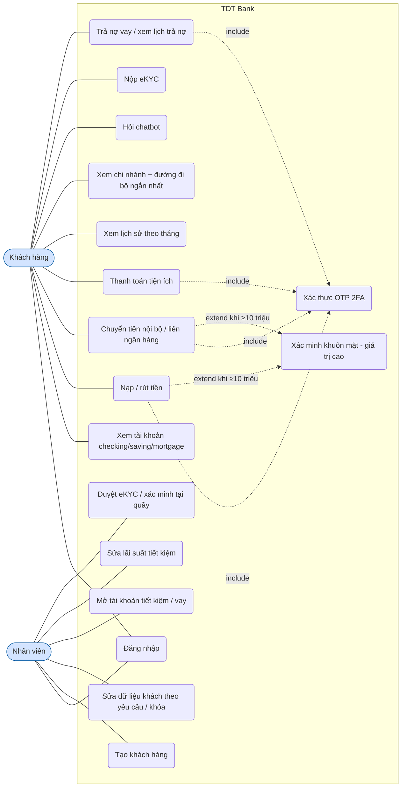
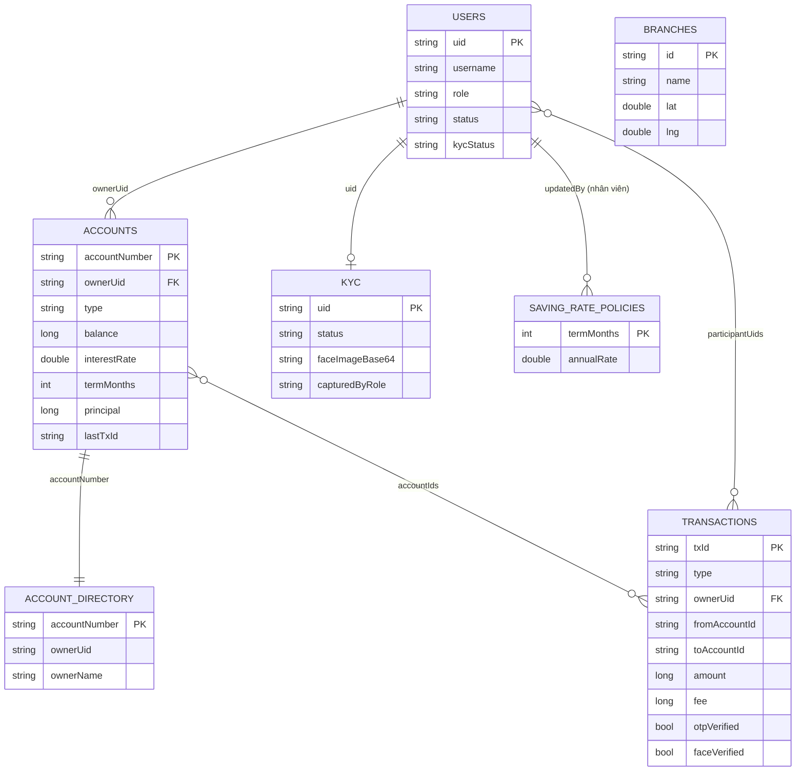
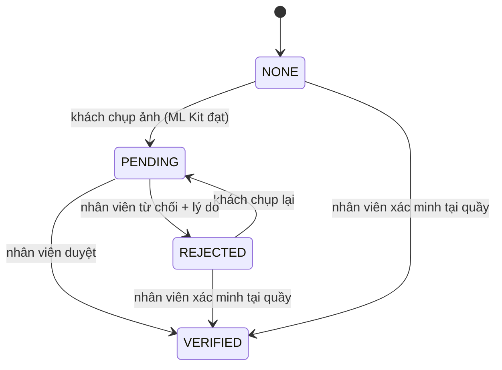
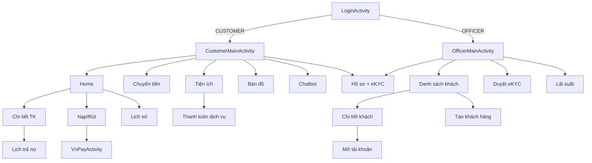

# Sơ đồ UML / ER

Các sơ đồ dùng Mermaid (GitHub hiển thị trực tiếp). Tên lớp, trường và quan hệ được viết theo mã nguồn hiện có.

## 1. Use case



## 2. Class diagram – model và domain

```mermaid
classDiagram
  class User { +String uid +String username +Role role +String fullName +String phone +String contactEmail +String nationalId +String address +String dateOfBirth +UserStatus status +KycStatus kycStatus +Timestamp createdAt +String createdBy }
  class Account { +String accountNumber +String ownerUid +String ownerName +AccountType type +AccountStatus status +long balance +double interestRate +int termMonths +long principal +PaymentFrequency paymentFrequency +String startDate +String lastTxId }
  class AccountDirectoryEntry { +String accountNumber +String ownerUid +String ownerName +AccountType type }
  class BankTransaction { +String id +TxType type +String ownerUid +String fromAccountId +String toAccountId +List participantUids +List accountIds +long amount +long fee +long principalPortion +UtilityCategory category +String gateway +boolean otpVerified +boolean faceVerified +Timestamp createdAt }
  class KycRecord { +String uid +String faceImageBase64 +KycStatus status +String capturedBy +Role capturedByRole +boolean faceDetected +boolean livenessPassed +String reviewedBy }
  class SavingRatePolicy { +int termMonths +double annualRate +String updatedBy }
  class Branch { +String id +String name +String address +double lat +double lng }
  class TxDraft { +String txId +TxType type +Account from +String toAccountNumber +long amount +long principalPortion +fingerprint() String }

  class TransactionRules { <<static>> +validate() Error +feeFor(TxType) long +requiresFaceVerification(long) boolean +isOutgoing(TxType) boolean }
  class OtpManager { +issue(fingerprint, now) String +verify(code, fingerprint, now) Result +remainingAttempts() int +clear() }
  class SavingsCalculator { <<static>> +monthlyProfit() long +profitAtMaturity() long }
  class MortgageCalculator { <<static>> +periodicPayment() long +schedule() List~Installment~ +nextInstallmentIndex() int }
  class GeoUtils { <<static>> +haversineMeters() double +nearest() List }
  class ChatIntentEngine { <<static>> +detect(String) Intent }
  class VnPayUrlBuilder { +buildPaymentUrl() String +verifyReturn(Map) boolean +isConfigured() boolean }

  User "1" --> "0..*" Account : sở hữu
  Account "1" --> "0..*" BankTransaction : tham gia
  User "1" --> "0..1" KycRecord
  Account "1" ..> "1" AccountDirectoryEntry : có
  TxDraft ..> Account
  TransactionRules ..> TxType
  MortgageCalculator ..> PaymentFrequency
```



## 3. Class diagram – tầng dữ liệu, ViewModel, UI

```mermaid
classDiagram
  class QueryLiveData~T~
  class DocumentLiveData~T~
  class Resource~T~ { +Status status +T data +String message }
  class AuthRepository { +login() +restoreSession() +logout() +changePassword() +createLoginAccount() }
  class UserRepository { +observeCustomers() +createCustomer() +officerUpdateCustomer() +setStatus() +updateOwnContact() }
  class AccountRepository { +observeAccounts() +observeAccount() +lookupDirectory() +openAccount() +generateUniqueNumber() }
  class TransactionRepository { +commit(TxDraft) +observeByUser() +observeByAccount() +getTodayOutgoing() }
  class KycRepository { +submit() +review() +observePending() }
  class RateRepository { +observePolicies() +updateRate() +createSamplePolicies() }
  class BranchRepository { +observeBranches() }
  class BaseViewModel { +operation() LiveData }
  class AccountViewModel
  class TransactionViewModel { +validate() +commit() +lookupAccount() }
  class OfficerViewModel
  class ProfileViewModel
  class ChatViewModel { +send(String) }
  class MapViewModel { +findNearest() }
  class SessionViewModel
  class AuthViewModel
  class TransactionFlow { +start(TxDraft, Listener) }
  class BaseShellActivity { <<abstract>> }
  class CustomerMainActivity
  class OfficerMainActivity
  class LoginActivity

  BaseViewModel <|-- OfficerViewModel
  BaseViewModel <|-- ProfileViewModel
  BaseShellActivity <|-- CustomerMainActivity
  BaseShellActivity <|-- OfficerMainActivity
  AccountViewModel --> AccountRepository
  AccountViewModel --> TransactionRepository
  TransactionViewModel --> TransactionRepository
  TransactionViewModel ..> TransactionRules
  OfficerViewModel --> UserRepository
  OfficerViewModel --> AccountRepository
  OfficerViewModel --> KycRepository
  OfficerViewModel --> RateRepository
  ProfileViewModel --> KycRepository
  MapViewModel --> BranchRepository
  ChatViewModel ..> ChatIntentEngine
  AccountRepository ..> QueryLiveData
  AccountRepository ..> DocumentLiveData
  TransactionFlow --> TransactionViewModel
  TransactionFlow ..> OtpManager
  LoginActivity --> AuthViewModel
```



## 4. ER (Firestore – các collection và quan hệ logic)



## 5. Sequence – chuyển tiền nội bộ có OTP (và khuôn mặt khi ≥ 10 triệu)

```mermaid
sequenceDiagram
  actor U as Khách hàng
  participant F as TransferFragment
  participant T as TransactionFlow
  participant VM as TransactionViewModel
  participant R as TransactionRepository
  participant FS as Firestore + Rules
  U->>F: nhập tài khoản nhận, số tiền
  F->>VM: lookupAccount(số)
  VM->>FS: get accountDirectory/{số}
  FS-->>F: tên chủ tài khoản
  F->>T: start(TxDraft)
  T->>VM: validate (TransactionRules + tổng chi hôm nay)
  alt ≥ 10.000.000 ₫
    T->>U: chụp mặt (mỉm cười) + ML Kit
  end
  T->>U: OTP dialog (SMS mô phỏng)
  U-->>T: nhập OTP đúng
  T->>VM: commit(draft, otp=true, face)
  VM->>R: commit
  R->>FS: WriteBatch{ create transactions/tx; update nguồn -(amount+fee); update đích +amount }
  FS-->>R: OK (Rules đối chiếu getAfter) hoặc PERMISSION_DENIED
  R-->>F: biên lai
```

## 6. State – eKYC



## 7. Điều hướng


